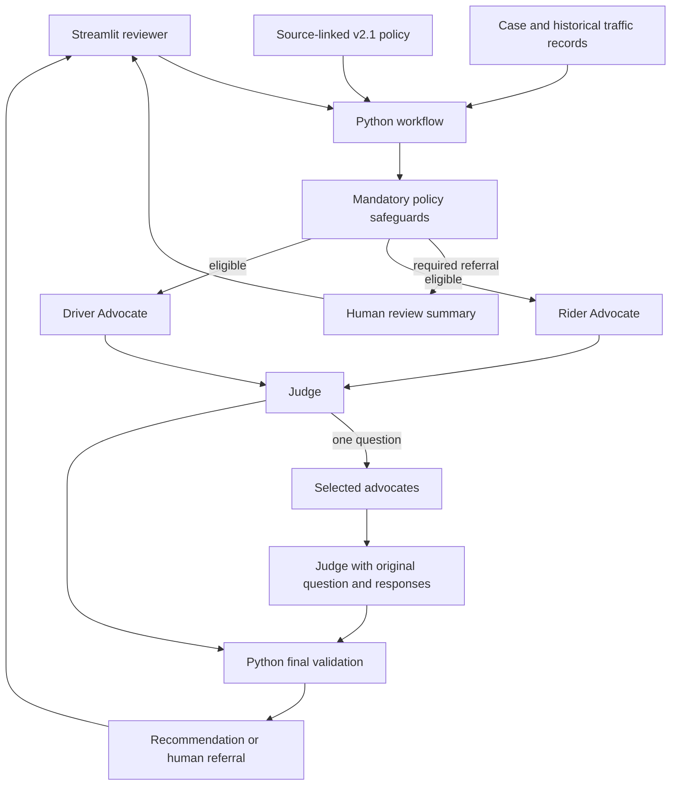

# FairRide project guide

Updated 14 October 2026. FairRide reviews rider–driver disputes using separate advocates, an impartial Judge, cited evidence and Python policy checks. It supports no-show charges and route deviations for the Digital Native hackathon track.

## Governing reference

The user selected the supplied `data/Document 2 — Ryde Dispute Resolution Policy v2.1 (Markdown).md`. Active JSON policies are `policies/ryde_v2_1_no_show.json` and `policies/ryde_v2_1_route_deviation.json`. These are project reference material; public Ryde policy has not been independently authenticated. Archived sample rules must not govern current runs.

Read `POLICY_V2_1_SPEC.md` for interpretations and unresolved details, and `PERSON_B_HANDOFF.md` for exact interfaces. Older increment 1 specs are historical proposals.

## Users and scope

A reviewer selects a case, sees evidence and cited agent activity, and receives either a validated recommendation or a human-review summary. Riders and drivers receive a clear explanation. Refunds, credits and account restrictions are never executed.

No-show eligibility requires five pickup minutes no earlier than scheduled time, verified arrival, a message and a call before cancellation. Route rules use additional kilometres, historical traffic, timely notification/agreement and excess-distance fare. Safety, routes above 2 km, disputes above SGD 50, or unmet confidence requirements must be referred. The source's partial-refund formula for a justified but unnotified detour is unresolved; the user chose referral until confirmed.

Fare/surge and property-damage material is retained as reference, but those workflows are not implemented. Unsupported categories are referred.

## Architecture and flow

Python controls order and one-round limits. The model generates arguments and explanations; contracts, source lookups, calculations and policy safeguards remain in application code. Plain API calls are sufficient; no orchestration framework or vector database is required.

## Current implementation

Eleven cases include valid/invalid no-shows, above-limit route referrals, a2km unjustified deviation, a1.5km component refund, a justified/agreed detour and conflicting traffic history. Source records and expected evaluation labels remain separate. Hand-written example mode exercises the real controller without API calls.

Live calls use `FAIRRIDE_API_KEY` or `OPENAI_API_KEY`, required `FAIRRIDE_MODEL`, and optional `FAIRRIDE_BASE_URL`. The current backend uses the same model for all roles. Paid live tests require an explicit flag. Live performance under the new policy and UI execution still require verification.

## Work ownership

Person A owns evidence preparation, advocates, case fixtures, labels and evaluation. Person B owns Judge integration, workflow and deterministic final checks. Both review policy interpretations and integrate against contract v2.0. Changes to public interfaces must update tests, examples and handoff together.

## Evaluation and completion

Measure autonomous resolution, accuracy among final rulings, unnecessary referrals and operational failures separately. Policy-mandated referral is appropriate, but never a matching final ruling. Missing credentials and invalid outputs are failures. Report N/A when there are no final rulings. See `EVALUATION.md`.

Completion requires a green offline suite, coherent UI runs across both categories, explicitly authorized live evaluation, and a reproducible demo. Synthetic examples are integration tests, not proof of model accuracy.

## Submission work

Prepare an architecture diagram, source repository, walkthrough, title, short blurb, description and16:9cover image. Retain CodeBuddy/WorkBuddy development-conversation evidence required by the supplied brief. Its listed submission date is16October2026; verify any organizer updates before submission.
